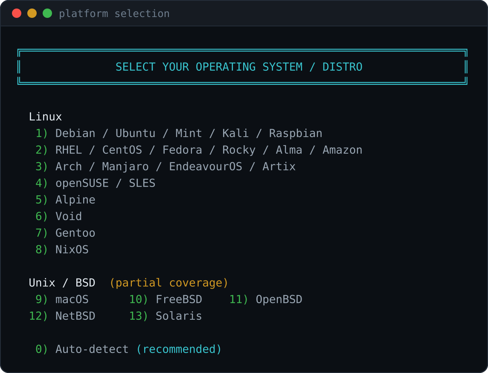
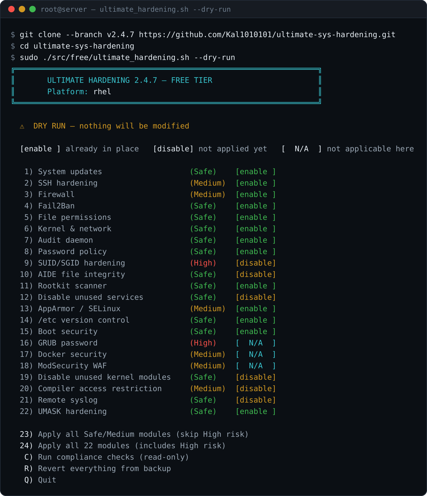
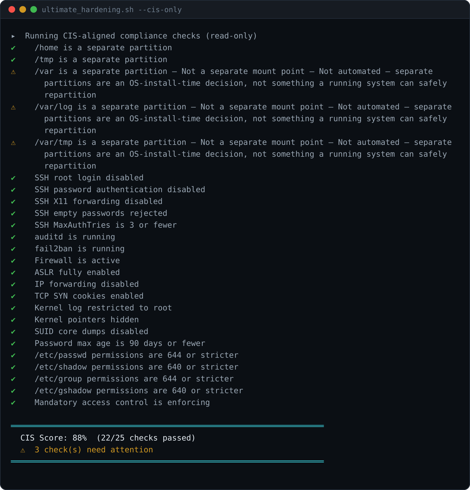

<div align="center">

# Ultimate Hardening

**CIS-aligned Linux hardening that fixes what it finds — with backup, dry-run, and full revert.**

[](https://github.com/Kal1010101/ultimate-sys-hardening/actions/workflows/shellcheck.yml)
[](LICENSE)
[](https://www.shellcheck.net/)
[](#supported-systems)

[Website](https://Kal1010101.github.io/ultimate-sys-hardening/) ·
[Security policy](SECURITY.md) ·
[Packer example](examples/packer/) ·
[Releases](https://github.com/Kal1010101/ultimate-sys-hardening/releases) ·
[Changelog](CHANGELOG.md)

</div>

---

## About this project

Ultimate Hardening is a one-person open-source project: a Bash tool that audits a
Linux host against CIS-aligned checks, applies the fixes, and can put everything
back. It started as a personal tool and is built the way I would want a tool that
runs as root on my own servers to be built.

**What it demonstrates**

- **Safe automation of risky changes.** Every file is backed up before the first
  write, the original state is kept separately, `--dry-run` shows each change
  first, and `--revert` restores it. SSH config is validated with `sshd -t` and
  rolled back automatically if it fails.
- **Portability, tested rather than claimed.** 22 modules across 8 Linux families
  (plus macOS and the BSDs, detected and adapted); every push runs the
  integration suite in a fresh container on each of 10 distro images, plus
  ShellCheck. The tests apply real hardening and assert the system actually
  changed.
- **Learning from failure in public.** An early version broke a login screen on an
  eCryptfs system; PAM modification was removed entirely and the reason is
  written down in [SECURITY.md](SECURITY.md). Fixes are recorded in the
  [changelog](CHANGELOG.md).
- **Honest scope.** The "Standards coverage" table says what is available, what is
  coming soon, and what is not certified.
- **Plain, reviewable code.** Plain Bash, MIT licensed, no telemetry, no phone-home.

---

Most hardening tools audit and hand you a report. This one audits, applies the
fixes, and keeps a way back. Every file it touches is backed up first, and
`--revert` restores from that backup.

```bash
# See exactly what it would change — writes nothing
sudo ./src/free/ultimate_hardening.sh --auto-mode --safe-only --dry-run

# Apply it (--safe-only leaves out the two High-risk modules)
sudo ./src/free/ultimate_hardening.sh --auto-mode --safe-only

# Changed your mind
sudo ./src/free/ultimate_hardening.sh --revert
```

## Quick start

### Try it first in a throwaway container

Nothing touches your machine: the container is deleted when you quit. This
opens the interactive menu in dry-run mode on Ubuntu (for Rocky Linux, use
`rockylinux:9` and `dnf install -y git openssh-server`):

```bash
docker run --rm -it ubuntu:24.04 bash -c "apt-get update -qq && apt-get install -y -qq git ca-certificates openssh-server >/dev/null && git clone --branch v2.5.3 https://github.com/Kal1010101/ultimate-sys-hardening.git && cd ultimate-sys-hardening && ./src/free/ultimate_hardening.sh --dry-run"
```

Swap `--dry-run` for `--cis-only` to see the compliance score, or apply it
for real with `--auto-mode`; it is a container, so nothing is at stake.

### Install a release package

Each release attaches `.deb`, `.rpm`, `.apk` and Arch packages plus a
`SHA256SUMS` file to its [release page](https://github.com/Kal1010101/ultimate-sys-hardening/releases).
Check the checksum before installing:

```bash
V=2.5.3
BASE=https://github.com/Kal1010101/ultimate-sys-hardening/releases/download/v$V
curl -fLO "$BASE/ultimate-hardening_${V}_all.deb"      # RHEL family: ultimate-hardening-${V}-1.noarch.rpm
curl -fLO "$BASE/SHA256SUMS"
sha256sum --check --ignore-missing SHA256SUMS
sudo apt install "./ultimate-hardening_${V}_all.deb"   # RHEL family: sudo dnf install ./ultimate-hardening-${V}-1.noarch.rpm
sudo ultimate-harden --dry-run --auto-mode             # preview, changes nothing
```

Installing a package only places files; it applies nothing until you run
`ultimate-harden`. See [docs/installation.md](docs/installation.md) for Alpine
and Arch.

### Or run it from a checkout

```bash
git clone --branch v2.5.3 https://github.com/Kal1010101/ultimate-sys-hardening.git
cd ultimate-sys-hardening
sudo ./src/free/ultimate_hardening.sh
```

This checks out the latest release, not `main`. To upgrade later:
`git fetch --tags && git checkout v<new version>`.

Running it with no flags opens an interactive menu. Nothing is applied without
confirmation.

## What it hardens

22 modules, each independently selectable from the menu. The interactive menu
shows a live `[enable ]` / `[disable]` / `[  N/A  ]` status per module, derived
from the same compliance checks `--cis-only` runs:

| # | Module | Risk | What it does |
|---|--------|------|--------------|
| 1 | System updates | Safe | Distro-aware package upgrade |
| 2 | SSH hardening | Medium | 13 settings, validated with `sshd -t` before restart. Password and root login are turned off only when an account other than root has an SSH key (`UH_SSH_LOCKOUT_CHECK=false` skips the check) |
| 3 | Firewall | Medium | nftables, UFW or firewalld — default-deny inbound on **IPv4 and IPv6** |
| 4 | Fail2Ban | Safe | SSH jail, ban after 3 failures |
| 5 | File permissions | Safe | `/etc/shadow`, `/etc/passwd`, sticky `/tmp` |
| 6 | Kernel / network | Safe | 27 sysctl parameters — ASLR, SYN cookies, martians |
| 7 | Auditd | Safe | 17 rules — identity, sudoers, module loading, mounts |
| 8 | Password policy | Safe | `login.defs` only — **PAM is never modified** |
| 9 | SUID/SGID | **High** | Strips SUID outside a safe list, inventory recorded |
| 10 | AIDE | Safe | File integrity baseline + daily cron check |
| 11 | rkhunter | Safe | Rootkit scanner with daily scan |
| 12 | Disable services | Safe | 20 unnecessary services |
| 13 | AppArmor / SELinux | Medium | Enforce mode (AppArmor profiles in complain mode, recorded for revert) |
| 14 | etckeeper | Safe | Git version control for `/etc` |
| 15 | Boot security | Safe | GRUB permissions, USB storage blacklist (`UH_USB_STORAGE_BLACKLIST=false` skips it) |
| 16 | GRUB password | **High** | PBKDF2 bootloader password; interactive only |
| 17 | Docker security | Medium | Inter-container comms off, live-restore, log rotation, merged into your daemon.json; userns-remap where Docker holds no data yet. `--dry-run` says whether Docker would restart and warns when containers share the default bridge |
| 18 | ModSecurity | Medium | WAF + core rule set, only if Apache/httpd is present |
| 19 | Unused kernel modules | Safe | Blacklists DCCP, SCTP, RDS, TIPC and the CIS uncommon filesystems (cramfs, freevxfs, hfs, hfsplus, jffs2, squashfs, udf). squashfs is left alone where snapd needs it. |
| 20 | Compiler access | Medium | Restricts gcc/clang to root, records original modes |
| 21 | Remote syslog | Safe | Forwards to a collector over UDP, TCP or TLS (`UH_SYSLOG_PROTO`, `UH_SYSLOG_TLS_CA`). TLS verifies the collector and queues to disk while it is unreachable. |
| 22 | UMASK hardening | Safe | Default umask 027 |

## Trust

You're being asked to run a script as root that rewrites SSH and firewall config.
Here's what it does and doesn't do:

- **No telemetry.** No analytics, no phone-home. The only outbound traffic
  is your own package manager, plus the update check if you run it from the
  menu or with `--check-update` (one request to the public GitHub API).
- **Backup before write.** Everything modified is copied to
  `/root/hardening_backup_<timestamp>_<tier>/` before the first change, with a
  manifest recording which tier and version wrote it.
- **Original state kept separately.** The first-ever copy of each file it
  touches is also kept in `/root/.ultimate_hardening_genesis/`, so a revert
  restores the system as it was before any hardening — not merely as it was
  before the most recent run.
- **Full revert.** `--revert` restores SSH, sysctl, file permissions, compiler
  modes, and removes the protocol and filesystem blacklists and the umask
  profile it added. `--revert-suid` restores just SUID/SGID bits.
- **Per-module revert.** Any module already applied can be backed out on its
  own from the menu, without reverting the rest.
- **Dry-run.** `--auto-mode --dry-run` prints every intended change, modifies
  nothing and exits. On its own, `--dry-run` opens the menu in preview mode.
- **PAM untouched.** An early version broke a login screen on an eCryptfs system.
  PAM modification was removed entirely — see [SECURITY.md](SECURITY.md).
- **SSH config is checked before restart.** The config is validated with
  `sshd -t` and rolled back automatically if it fails. That catches a broken
  config, not a lost login: root login and password authentication are turned
  off, so set up key access for a non-root sudo user first.
- **Dependencies resolved before the first write.** Applying everything checks
  each module's packages up front and names anything it cannot obtain, so you
  find out before the run rather than forty seconds into a half-hardened host.
- **An upgrade that would break the next boot fails loudly.** After a kernel
  upgrade the boot image is checked for every new kernel plus the one that
  boots next, rebuilt if stale, and the module reports failure — rather than
  "updated" — if it still is not right.

## Supported systems

Auto-detected, or selectable from a menu.

**Linux** — Debian, Ubuntu, Mint, Kali, Raspbian, RHEL, CentOS, Fedora, Rocky,
AlmaLinux, Amazon Linux, Arch, Manjaro, EndeavourOS, Artix (untested),
openSUSE, SLES, Alpine, Void, Gentoo, NixOS

*Artix is detected and treated as Arch, but it has not been tested. It runs
without systemd, so service handling takes a different path than on Arch.*

**Unix / BSD** — macOS (Homebrew), FreeBSD, OpenBSD, NetBSD, Solaris
*(detected and adapted; coverage is thinner than Linux)*

Package managers: `apt`, `dnf`, `yum`, `pacman`, `zypper`, `apk`, `xbps`,
`emerge`, `brew`, `pkg`, `nix`
Init systems: systemd, OpenRC, SysV, BSD rc.d

## Usage

```
sudo ./src/free/ultimate_hardening.sh [OPTIONS]

  --auto-mode      Run without interactive prompts
  --safe-only      With --auto-mode, skip the two High-risk modules (9, 16)
  --dry-run        Show what would change, apply nothing
  --cis-only       Run read-only CIS checks, print score, exit
  --json           Like --cis-only, but print the results as JSON on stdout
  --sarif          Like --cis-only, but print them as SARIF 2.1.0 (code scanning)
  --skip-backup    Skip creating the backup directory (disables revert)
  --revert         Restore everything from backup
  --revert-suid    Restore only SUID/SGID permissions
  --aide-refresh   Update the AIDE baseline, after showing the changes for approval
  --aide-fingerprint
                   Record the fingerprint of the current AIDE baseline
  --aide-verify <hash|file>
                   Check the AIDE baseline against a fingerprint kept elsewhere
  --check-update   Check GitHub for a newer release, then exit
  --version        Print version and exit
  --help           Show this help
```

Settings such as the USB storage blacklist, backup location and retention, and
the remote syslog destination are environment variables. They are listed with
their defaults in [`examples/.env.example`](examples/.env.example); pass one
directly with `sudo UH_USB_STORAGE_BLACKLIST=false ./src/free/ultimate_hardening.sh`.

### Skipping single settings

When one setting conflicts with how a host is used, leave that setting alone
instead of skipping its whole module. `UH_SKIP_SETTINGS` takes sshd keywords,
`login.defs` keys and sysctl keys, separated by spaces or commas; shell patterns
work:

```bash
sudo UH_SKIP_SETTINGS="AllowTcpForwarding net.ipv6.*" ./src/free/ultimate_hardening.sh --auto-mode
```

Each skipped setting is named in the output, and `--dry-run` counts it. The
compliance checks still report a skipped setting as failing, since the host
does not meet it.

### Compliance results for scripts and CI

`--json` and `--sarif` run the same read-only checks as `--cis-only` and print
only the document on stdout; everything else goes to stderr. JSON carries the
score and, per check, an id, title, pass/fail, detail, owning module and
suggested fix. SARIF lists every check as a rule and each failed check as a
result, for GitHub code scanning or any SARIF viewer:

```bash
sudo ./src/free/ultimate_hardening.sh --json | jq '.checks[] | select(.passed == false) | .title'
sudo ./src/free/ultimate_hardening.sh --sarif > hardening.sarif
```

Both exit 0 whatever the score, as `--cis-only` does; read the score from the
document to gate a pipeline.

### Ansible

[`ansible/`](ansible/) holds a role that installs a release package (checked
against `SHA256SUMS`), then previews, applies or scores the hardening on each
host and can save every host's results as JSON. It defaults to a dry run, and
`ansible-playbook --check` always runs the tool's own dry run.

### AIDE baseline fingerprint

Each time an AIDE baseline is accepted (`--aide-refresh`, or module 10 building
the first one), the tool prints the database's SHA-256 fingerprint and:

- saves it in `/var/lib/ultimate-hardening/aide-fingerprint`, root-owned and
  readable by all, since it is not secret;
- sends it to syslog, so remote log forwarding, when set up, puts a copy on the
  collector;
- offers to copy it to a drive. The folder you give is remembered: press Enter
  to use it again, type a new one, or type `skip`. Unattended runs use the saved
  folder without asking, and only when it is on another filesystem than this
  machine's own, so an unmounted drive is never mistaken for one. A copy is
  always a new file; existing files are never written over;
- prints an `scp` command to fetch it from another machine, as the account that
  ran sudo. Run it on the machine the drive is plugged into: the drive prompt
  only sees drives mounted on this one. For example:

  ```bash
  scp user@192.168.xx.xx:/var/lib/ultimate-hardening/aide-fingerprint ./aide-fingerprint-user-20261103-1322.txt
  ```

Check the baseline later against a copy you kept:

```bash
sudo ./src/free/ultimate_hardening.sh --aide-verify /media/you/BACKUP/aide-fingerprint-host-....txt
sudo ./src/free/ultimate_hardening.sh --aide-verify 'z/KpcAIiebD95YHH8Pdjn5+MGhRzcfoEVbWDW6BDvjs='
```

Exit status: 0 matches, 1 does not match, 2 could not check. If you accepted a
baseline by hand, record it with `--aide-fingerprint` after reading its report.
Pro and Enterprise also compare the database with the saved fingerprint during
every compromise scan.

**Limits.** Anything that runs on the machine, `--aide-verify` included, can be
faked by someone who already has root there: they can change the database, the
saved copy and the tool together. Only the copies you keep elsewhere cannot be
changed from the machine. The strongest check hashes the database on another
machine, so that the machine being checked does not do the hashing:

```bash
ssh host sudo cat /var/lib/aide/aide.db | zcat -f | openssl dgst -sha256 -binary | base64
```

That still trusts the machine's kernel to hand over the real file; only booting
from trusted media removes that.

## CI and image builds

`--cis-only` exits after printing a machine-readable score, which makes it usable
as a build gate:

```bash
score=$(sudo ./src/free/ultimate_hardening.sh --cis-only | grep -oP 'CIS Score: \K[0-9]+')
[ "$score" -lt 80 ] && exit 1
```

See [`examples/packer/`](examples/packer/) for a complete golden-image pipeline
that hardens an AMI and fails the build if the score regresses.

## Tiers

The free tier is MIT licensed with no expiry: all 22 hardening modules, the
CIS checks, dry-run and full revert. It is actively developed: tagged releases,
a changelog, and a module set that keeps growing. Paid tiers run the same 22 modules and add
reporting, fleet management and a few extra hardening modules on top.

What the free tier looks like:

<div align="center">
<table>
<tr>
<td align="center" width="33%">
  <a href="docs/images/readme/distro-menu.png"></a>
  <br><sub><b>Pick a platform</b><br>or let it auto-detect</sub>
</td>
<td align="center" width="33%">
  <a href="docs/images/readme/overview.png"></a>
  <br><sub><b>All 22 modules</b><br>status read live, never remembered</sub>
</td>
<td align="center" width="33%">
  <a href="docs/images/readme/compliance-check.png"></a>
  <br><sub><b>Score it, change nothing</b><br>each failure names its fix</sub>
</td>
</tr>
</table>
<sub><i>Click any shot to open it full size.</i></sub>
</div>

The free tier stands on its own. Everything a single host needs is here and
stays here: the 22 modules, the compliance checks with their results as JSON or
SARIF (`--json`, `--sarif`), per-setting exclusions, dry-run and full revert.

Pro and Enterprise are not released yet. When they are, they run these same 22
modules unchanged. Pro adds reports, scheduled runs with email alerts, a waiver
register and three extra hardening modules; Enterprise adds fleet management:
a multi-host dashboard, remote deploy, policy-as-code with drift detection,
GitOps delivery and OpenSCAP scanning. Nothing moves out of the free tier to
make room for them. [What each tier adds →](https://Kal1010101.github.io/ultimate-sys-hardening/#pricing)

## Standards coverage

Honest scope — including the gaps. Rows marked Pro or Enterprise arrive with
those tiers, which are coming soon.

| Standard | Status |
|----------|--------|
| CIS Benchmarks | CIS-**aligned** checks. Not a certified CIS-CAT implementation. |
| Automated remediation | Available |
| Continuous compliance / drift | Enterprise |
| OpenSCAP | Enterprise — wraps `oscap`, folds results into reports |
| Packer / Terraform | Available — [example included](examples/packer/) |
| Fleet scale | Enterprise — small fleets (tens of hosts). Remote deploy is a sequential SSH loop. |
| DISA STIG | Enterprise **scanning** — `--scap-profile stig` against the distro's SSG content. STIG-specific remediation is not mapped. |
| PCI-DSS / HIPAA / ANSSI / others | Enterprise scanning wherever the distro's SSG content ships that profile — `--scap-list-profiles` shows which. |
| Exception register | Pro — accepted risks with a justification and a review date |
| Vulnerability exposure | Pro — CVEs affecting the installed packages, from your own package manager's repository metadata (RHEL family, SUSE). Debian/Ubuntu metadata has no CVE IDs, so they need the opt-in `--cve-feeds` download. Optional ranking by CISA KEV and EPSS (`--cve-enrich`, also opt-in). |
| SBOM | Pro — CycloneDX 1.5 or SPDX 2.3 JSON |
| Compromise detection | Pro — read-only indicator-of-compromise scan with a baseline, so later runs show only what changed. It runs on the host it checks, so a rootkit with root access can still hide from it; for high assurance, check from trusted boot media. Enterprise adds a per-host view in the dashboard and `--remote` scans. |
| TLS log forwarding | Available — all tiers, module 21 |
| USB / removable media | Free: all-or-nothing — module 15 blocks every USB storage device, or none with `UH_USB_STORAGE_BLACKLIST=false`. Pro and Enterprise: per-device allow-list on usbguard — devices connected at setup keep working, new ones are blocked (where the distro packages usbguard). |
| NIST SP 800-70 | Roadmap |
| Ansible role | Available — [`ansible/`](ansible/) |

## Roadmap

- [ ] DISA STIG remediation mapping (STIG scanning comes with Enterprise — see above)
- [ ] NIST SP 800-70 checklist mapping
- [x] Ansible role ([`ansible/`](ansible/))
- [ ] Parallel remote deploy (beyond sequential SSH)
- [ ] Service-impact simulation before apply (started: `--dry-run` warns before an SSH lockout and before Docker changes that would disrupt containers)

## Contributing

Issues and PRs welcome. Every push runs ShellCheck, and the integration suite
in a fresh container on each of 10 distro images (Ubuntu 22.04 and 24.04,
Debian 12, Rocky 8 and 9, AlmaLinux 8 and 9, Fedora 40, Arch, Alpine) — please
make sure both pass locally first:

```bash
# the same invocation CI uses
shellcheck --severity=warning -x -e SC2034 -e SC1091 -e SC2154 \
    lib/*.sh src/free/ultimate_hardening.sh scripts/*.sh \
    tests/*.sh tests/lib/*.sh tests/cases/*.sh
bash -n lib/*.sh src/free/*.sh

# the integration suite, in throwaway containers (needs docker)
./tests/run.sh --distro debian:12
./tests/run.sh --all-distros
```

`tests/run.sh` applies real hardening inside a container and asserts the system
actually changed, which is the difference between "the script parses" and "the
script works". Bootstrap packages are installed once per distro image and
reused, so each case starts from a clean container without reinstalling them.
Tests that stub a command must stub it with a shell **function**:
`lib/core.sh` prepends the system directories to `PATH` when it is sourced, so a
stub directory put on `PATH` beforehand is shadowed by the real binary.

Security issues go through [SECURITY.md](SECURITY.md), not the public tracker.

## License

MIT — see [LICENSE](LICENSE).
